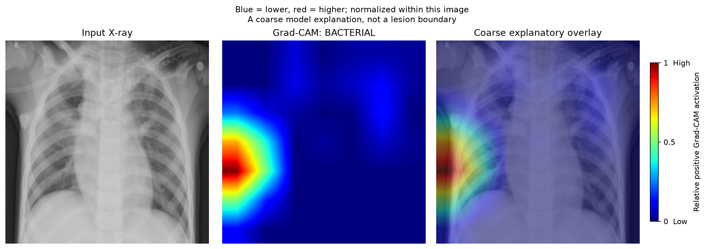

# 🫁 Interpretable Multiclass Chest X-Ray Diagnosis with MobileNetV2 & Grad-CAM

[](https://pytorch.org/)
[](https://streamlit.io/)
[](https://github.com/Loai-Alrazi)
[](https://opensource.org/licenses/MIT)

> An academic Deep Learning research project for automated 3-class pediatric chest radiograph screening (**Bacterial Pneumonia**, **Viral Pneumonia**, and **Normal**). Engineered with **MobileNetV2** transfer learning, multi-seed validation with paired bootstrap comparisons clustered by patient group, and **Grad-CAM (Gradient-weighted Class Activation Mapping)** for qualitative visual inspection.

> [!IMPORTANT]
> **Research & Educational Disclaimer:** This system is developed solely for scientific research and educational demonstration. It is not approved by medical regulatory authorities for primary clinical diagnosis or autonomous patient triage. All diagnostic decisions must be made by qualified healthcare professionals.

---

## 🌟 Key Highlights

- **3-Class Differential Diagnosis:** Distinguishes **Bacterial vs. Viral** pneumonia rather than binary detection, addressing the key clinical challenge of antibiotic stewardship.
- **Dual-Model Academic Architecture:** Exposes both the **Controlled Experimental Baseline (Exp 2)** and the **Validation Winner (Exp 5)** with full disclosure of validation metrics and out-of-distribution trade-offs.
- **Group-Separated Splits:** No overlap of filename-derived patient groups and no identical images between training ($2,837$ groups, $3,834$ images), validation ($714$ groups, $925$ images), and historical test splits ($432$ groups, $624$ images). Groups are derived from filenames, not verified patient identifiers (see [Data Splits](#-data-splits--patient-groups)).
- **Explainable AI (Grad-CAM):** Generates coarse class-activation heatmaps from the final convolutional feature map to support qualitative inspection for shortcut learning.
- **Dual Interfaces:** Includes both an interactive **Streamlit Web Dashboard (`app_streamlit.py`)** with real-time model switching and a **CLI Tool (`predict.py`)** with JSON output.
- **Lightweight & Edge-Ready:** Powered by MobileNetV2 (~8.9 MB checkpoint), enabling real-time inference ($<20\text{ ms}$ on GPU, sub-$200\text{ ms}$ on CPU).

---

## 📊 Comprehensive Validation Benchmark ($N=925$ Images, $714$ Patient Groups)

Model selection and architecture evaluations used the internal, group-separated Validation cohort ($404$ Bacterial, $270$ Normal, $251$ Viral). Overall accuracy mathematically equals support-weighted recall across all evaluated configurations:

$$\text{Accuracy} \equiv \text{Support-Weighted Recall} = \frac{404 \cdot R_{\text{bact}} + 270 \cdot R_{\text{norm}} + 251 \cdot R_{\text{viral}}}{925}$$

> [!NOTE]
> **Validation figures are optimistic.** The same validation set was used to choose each run's best epoch (early stopping on validation loss) and to choose among roughly ten configurations. Validation metrics, and especially the margin of the best configuration, therefore overstate expected performance on new data. No unbiased held-out estimate is available (see [Section B](#b-validation-vs-historical-test-observations)).

### Progression of Model Architectures

| Model Candidate | Architectural & Training Configuration | Single-Seed Val Macro F1 (Seed 42 / Mean $\pm$ SD¹) | 3-Seed Ensemble Val Macro F1 | Val Accuracy (Ensemble) | Normal Recall ($N=270$) | Viral Recall ($N=251$) | Bacterial Recall ($N=404$) | Unweighted Val Loss |
| :--- | :--- | :---: | :---: | :---: | :---: | :---: | :---: | :---: |
| **Exp 0**² | MobileNetV2, 3 epochs initial baseline, unweighted CE | $75.57\%$ (single) | — | $76.65\%$ | $93.33\%$ | $54.18\%$ | $77.97\%$ | $0.5584$ |
| **Exp 1** | MobileNetV2, 12 epochs linear head, unweighted CE | $76.30\%$ ($76.47\% \pm 0.27\%$) | $76.67\%$ | $77.41\%$ | $96.67\%$ | $57.77\%$ | $76.98\%$ | $0.5338$ |
| **Exp 2 (Baseline)** | **MobileNetV2, 12 epochs linear head, class-weighted CE** | **$77.55\%$** ($76.98\% \pm 0.53\%$) | **$77.17\%$** | **$77.73\%$** | **$96.67\%$** | **$60.16\%$** | **$75.99\%$** | **$0.5435$** |
| **Exp 5 (Val Winner)** | **MobileNetV2, top 4 feature blocks fine-tuned, weighted CE** | **$79.56\%$** ($79.33\% \pm 0.18\%$) | **$79.79\%$** | **$80.00\%$** | **$97.41\%$** | **$63.35\%$** | **$78.71\%$** | **$0.4984$** |

¹ Population SD (ddof = 0) across seeds 42, 123 and 456; the sample SD (ddof = 1) is about 22% larger.
² Exp 0 is the original released checkpoint (commit `057eee1`). `artifacts/model_exp0_baseline_3epochs.pt` is a later re-run with different weights and metrics (Val Macro F1 $74.72\%$).

### Controlled Experimental Interventions (Paired Bootstrap Clustered by Patient Group, $B=2,000$)

Three controlled hypotheses were tested against the established **Exp 2 Control Baseline** across seeds $42, 123, 456$:

| Experiment | Hypothesized Intervention | 3-Seed Ensemble Val Macro F1 | Paired $\Delta$ Macro F1 vs. Control [95% CI] ($p$-value) | Secondary Observations (nominal, unadjusted) | Outcome |
| :--- | :--- | :---: | :---: | :--- | :--- |
| **Exp A** | Contrast-Limited Adaptive Histogram Equalization (CLAHE) | $76.92\%$³ | $-0.28\%$ [$-2.08\%, +1.61\%$] ($p = 0.7776$) | Normal recall $\Delta = -2.25\%$ (nominal $p = 0.0330$) | No improvement over control |
| **Exp B** | Multi-Class Focal Loss ($\gamma = 2.0$) | $76.21\%$ | $-0.96\%$ [$-2.38\%, +0.36\%$] ($p = 0.1709$) | Viral recall $\Delta = -4.43\%$ (nominal $p = 0.0060$) | No improvement over control |
| **Exp C** | Frozen DenseNet-121 Backbone (`IMAGENET1K_V1`) | $76.85\%$ | $-0.34\%$ [$-2.36\%, +1.58\%$] ($p = 0.7516$) | Lower single-seed Macro F1 than control on all 3 seeds; $3.12\times$ parameters; $\approx 2.6\times$ latency³ | No improvement over control |

*Statistical notes:* Every Macro F1 confidence interval includes zero, so none of the interventions improved on the control. The secondary $p$-values are nominal and unadjusted for the 15 comparisons (3 experiments × 5 metrics). Under a Bonferroni correction ($\alpha \approx 0.0033$) neither reported secondary difference is significant, so both should be read as exploratory. The success criteria were not formally pre-registered. Bootstrap resampling units are the filename-derived patient groups described in [Data Splits](#-data-splits--patient-groups).

³ Reported from session output; not stored in the result artifacts (`artifacts/experiment_a_validated_results.json` stores per-seed values, with a 3-seed mean of $77.10\%$).

---

## 🔬 Model Taxonomy & Generalization Disclosures

### A. Model Role Definitions
1. **Controlled Experimental Baseline (Exp 2):**  
   MobileNetV2 with frozen backbone and class-weighted linear head ($3,843$ trainable head parameters). Serves as the minimal, transparent, and reproducible control anchor.
2. **Validation Winner (Exp 5):**  
   MobileNetV2 with the top 4 feature blocks unfrozen for fine-tuning (`features[15..18]`: three inverted residual blocks plus the final $1 \times 1$ convolution; $1,529,923$ trainable parameters including the head). Trained with class-weighted CE, head LR $5 \times 10^{-4}$, backbone LR $5 \times 10^{-5}$, weight decay $10^{-4}$, cosine schedule, at most 8 epochs with early stopping. Achieved the highest internal validation metrics ($79.79\%$ Macro F1, $80.00\%$ Accuracy in 3-seed ensemble).
3. **Academic Demonstration Architecture:**  
   The project packages **Exp 2 (Seed 42)** as the default checkpoint in `app/model.py` and `predict.py`, while exposing **Exp 5 (Seed 42)** as an optional comparison model in both the CLI and Streamlit.

#### Deployed Demonstration Checkpoints Performance (Validation Cohort: $N=925$)

| Model Role & Checkpoint | Trainable Params | Val Macro F1 | Val Accuracy ($N=925$) | Normal Recall ($N=270$) | Viral Recall ($N=251$) | Bacterial Recall ($N=404$) | Unweighted Val Loss |
| :--- | :---: | :---: | :---: | :---: | :---: | :---: | :---: |
| **Exp 2 (Seed 42) — Default Baseline** | **3,843** | $77.55\%$ | $77.95\%$ ($721/925$) | $95.19\%$ ($257/270$) | $61.75\%$ ($155/251$) | $76.49\%$ ($309/404$) | $0.5502$ |
| **Exp 5 (Seed 42) — Comparison Explorer** | **1,529,923** | $79.56\%$ | $79.46\%$ ($735/925$) | $96.67\%$ ($261/270$) | $65.74\%$ ($165/251$) | $76.49\%$ ($309/404$) | $0.4995$ |

*Verification:* Support-weighted accuracy matches exact counts ($721/925$ for Exp 2 s42 and $735/925$ for Exp 5 s42). Both models are strictly evaluated on deterministic validation transforms ($224 \times 224$, ImageNet normalization).

### B. Validation vs. Historical Test Observations
> [!WARNING]
> **The Test split is exposed and is not an unbiased estimate.** The official Kermany Test split ($N=624$, $234$ Normal) was evaluated repeatedly during development: the original Exp 0 notebook, single-checkpoint and multi-seed evaluations of Exp 1, Exp 2 and Exp 5, and a class-probability reweighting probe that was fitted on validation and scored on Test (not adopted). These results were available when Exp 2 was chosen as the default model. The figures below are descriptive historical observations only. They are attributed to the console output of the archived scripts (`experiments/archive/`) and the original notebook, and were not saved as artifacts.

| Model Benchmark | Evaluation Configuration | Validation Normal Recall ($N=270$) | Historical Test Normal Recall ($N=234$) | Historical Test Accuracy ($N=624$) |
| :--- | :--- | :---: | :---: | :---: |
| **Exp 2 Baseline (Single Checkpoint, s42)** | Deployed weights (weight-identical to `model_exp2_class_weighted_head.pt`) | $95.19\%$ ($257/270$) | $64.53\%$ ($151/234$) | $79.81\%$ ($498/624$) |
| **Exp 2 Baseline (3-Seed Ensemble)** | Probability average across seeds $42, 123, 456$ | $96.67\%$ ($261/270$) | $67.52\%$ ($158/234$) | $80.77\%$ ($504/624$) |
| **Exp 5 Standalone Run (Unsuffixed)** | Exploratory single run (10-epoch cap; not the deployed Exp 5 weights) | $97.78\%$ ($264/270$) | $53.42\%$ ($125/234$) | $75.32\%$ ($470/624$) |
| **Exp 5 Val Winner (3-Seed Ensemble)** | Multi-seed ensemble across seeds $42, 123, 456$ | $97.41\%$ ($263/270$) | $54.27\%$ ($127/234$) | $75.80\%$ ($473/624$) |

*Methodological & Provenance Notes:*
1. **Weights Provenance:** For Exp 2, the deployed Seed 42 checkpoint has weights identical to the standalone unsuffixed checkpoint evaluated on Test ($64.53\%$): all `state_dict` tensors are equal, and only the stored experiment name differs. For Exp 5, the historical single-model Test figure ($53.42\%$) belonged to an earlier exploratory checkpoint (`model_exp5_finetune_top4blocks.pt`), while the multi-seed Exp 5 cohort evaluated on Test showed a mean Normal recall of $55.41\% \pm 6.25\%$ ($54.27\%$ in ensemble).
2. **Generalization Gap:** While fine-tuning (Exp 5) yielded superior sensitivity on internal validation ($97.41\%$ ensemble Normal recall), the frozen-backbone baseline (Exp 2) demonstrated higher Normal recall on the historical Test cohort ($67.52\%$ vs. $54.27\%$). The causes of this divergence (e.g., potential sensitivity to scanner acquisition differences across hospital batches) remain unproven empirical observations and warrant prospective multi-center study before clinical utility could ever be considered.

---

## 🧬 Data Splits & Patient Groups

- **Source:** Kermany et al. (2018) pediatric chest X-rays (CC BY 4.0), in the classroom copy prepared by the course kit. Images were pre-resized to $224 \times 224$. Test is the original 624-image Kermany test split; validation was carved out of the original training pool by filename-derived group. The dataset is not distributed here.
- **Patient groups:** Pneumonia images are grouped by `person<ID>_bacteria` or `person<ID>_virus`, and Normal images by filename without its last `-` segment (`get_true_patient_id` in `experiments/archive/session_560df2be/eval_and_bootstrap_exp_a.py`). This gives $2,837$ / $714$ / $432$ groups. These are not verified patient identifiers: the same `person<ID>` can carry both bacterial and viral images, and grouping by `person<ID>` alone gives $2,140$ / $536$ / $427$ groups.
- **Integrity check:** Under either grouping, no group and no identical image (by SHA-256) appears in more than one split.
- **Demo images:** The six files in `sample_images/` come from the historical Test split and are for UI demonstration only.

## 🔁 Reproducibility

- **Training and evaluation code:** The scripts attributed to the Exp 1–6 and Exp A/B/C checkpoints, the bootstrap results and the historical Test evaluations were recovered from earlier working sessions and are preserved byte-for-byte in [`experiments/archive/`](experiments/archive/README.md). They were not re-executed, so their link to specific artifacts is attributed rather than verified (see the archive's evidence-status section). They use hardcoded local paths and write into `artifacts/`, so they are a historical record rather than a runnable pipeline.
- **Determinism evidence:** Independent re-runs of the Exp 2 configuration in Experiment A (`exp_a_control_s*.pt`) produced weights identical to `model_exp2_class_weighted_head_s*.pt` for all three seeds.
- **Notebook:** `notebooks/Pneumonia_Classification_Pipeline.ipynb` is the original Exp 0 coursework pipeline. It depends on the course kit's `helpers.py`, `prepare_three_classes.py` and data folder, and does not cover Exp 1–6 or A–C.

---

## 🔬 Visual Explainability with Grad-CAM

To help inspect whether predictions rely on lung regions rather than annotations, image borders or scanner artifacts, the pipeline integrates **Grad-CAM**:

<p align="center">
  
</p>
<p align="center"><em>Example produced with the original Exp 0 model.</em></p>

- **Warm Regions (Red/Yellow):** High contribution to the explained class score.
- **Cool Regions (Blue/Cyan):** Minimal activation.

Grad-CAM maps are computed at $7 \times 7$ resolution and upsampled. They are qualitative and have not been validated against radiologist annotations, so they cannot confirm that a prediction is driven by pathology.

---

## 🖥️ Interactive Web Application (Streamlit)

The application provides an interactive research and demonstration interface:
1. **Dynamic Model Switching:** Toggle between **Exp 2 Baseline** and **Exp 5 Validation Winner** directly in the sidebar.
2. **Image Input:** Drag-and-drop pediatric chest X-rays or choose from pre-loaded benchmarks.
3. **Probability Breakdown:** Real-time differential confidence distribution across Bacterial, Normal, and Viral categories.
4. **Interactive Saliency Controls:** Select any class for Grad-CAM inspection and adjust heatmap alpha overlay transparency.

```bash
# Launch the interactive web dashboard
streamlit run app_streamlit.py
```

---

## ⚡ Quickstart Guide

### 1. Installation
Clone the repository and set up your Python environment:

```bash
git clone https://github.com/Loai-Alrazi/pneumonia-multiclass-xray-classifier.git
cd pneumonia-multiclass-xray-classifier

# Create and activate virtual environment
python -m venv .venv
source .venv/bin/activate  # On Windows: .\.venv\Scripts\Activate.ps1

# Install dependencies
pip install -r requirements.txt
```

### 2. Command-Line Inference (CLI)
Run inference using either the default Exp 2 baseline or the Exp 5 validation variant:

```bash
# Run with default Exp 2 Baseline (Frozen MobileNetV2, Seed 42)
python predict.py --image sample_images/bacterial_pneumonia_sample_01.jpeg

# Run with Exp 5 Validation Winner (Top-4 Fine-Tuned, Seed 42)
python predict.py --image sample_images/bacterial_pneumonia_sample_01.jpeg --model exp5

# Generate and save a Grad-CAM explanation overlay
python predict.py --image sample_images/bacterial_pneumonia_sample_01.jpeg --gradcam --output outputs/gradcam_overlay.png

# Output structured JSON for automated pipelines
python predict.py --image sample_images/normal_sample_01.jpeg --json
```

### 3. Automated Unit Tests
Run the automated smoke tests. They cover model loading, checkpoint identity, failure on missing or mislabelled checkpoints, valid probability outputs (summing to 1), and Grad-CAM generation. They use synthetic images only and do not measure accuracy:

```bash
# Standalone dual-model test runner (Exp 2 & Exp 5)
python tests/run_tests.py

# Standard inference engine test suite (standalone Python or pytest)
python tests/test_inference.py
# or with pytest installed:
pytest tests/test_inference.py
```

---

## 📁 Repository Structure

```text
├── app/
│   ├── __init__.py           # Application package init
│   ├── model.py              # PneumoniaClassifier engine (Exp 2 & Exp 5 dual support)
│   └── gradcam.py            # Grad-CAM heatmap & overlay generation
├── artifacts/
│   ├── pneumonia_3class.pt                      # Default checkpoint (Exp 2, Seed 42)
│   ├── model_exp5_finetune_top4blocks_s42.pt    # Optional comparison checkpoint (Exp 5, Seed 42)
│   ├── checkpoint_validation_metadata.json      # Embedded validation metrics + SHA-256 of every local checkpoint
│   └── experiment_{a,b,c}_*.json                # Per-seed validation metrics & bootstrap results
├── docs/
│   ├── assets/               # Historical figures from the original Exp 0 model (incl. Test confusion matrix)
│   └── CLINICAL_NOTES.md     # Radiological differential criteria & ethical scope
├── experiments/archive/      # Byte-identical training/evaluation scripts (provenance record, not runnable as-is)
├── notebooks/                # Original Exp 0 coursework notebook (requires the course kit)
├── sample_images/            # Six demo images from the historical Test split
├── tests/
│   ├── run_tests.py          # Standalone test runner
│   └── test_inference.py     # Unit test definitions
├── app_streamlit.py          # Streamlit multiclass triage web application
├── predict.py                # Command-line interface (CLI) for single-image inference
├── requirements.txt          # Python dependencies
└── README.md                 # Project documentation
```

The remaining seed and ablation checkpoints (Exp 0–6 variants, Exp A/B/C; about 320 MB) are kept out of version control. Their per-checkpoint validation metrics and SHA-256 hashes are recorded in `artifacts/checkpoint_validation_metadata.json`. The 3-seed ensemble figures for Exp 1 and Exp 5 are reported from session output and are not stored as artifacts.

---

## ⚖️ License & Ethical Notice

- **License:** Distributed under the [MIT License](LICENSE).
- **Ethical Notice:** This software is an academic demonstration and research tool. It is not certified as a medical device and should not be used as a substitute for professional clinical judgment, diagnosis, or treatment.

---
**Author:** [Loay Alrazi](https://github.com/Loai-Alrazi) — Applied AI & Machine Learning Systems Engineer
