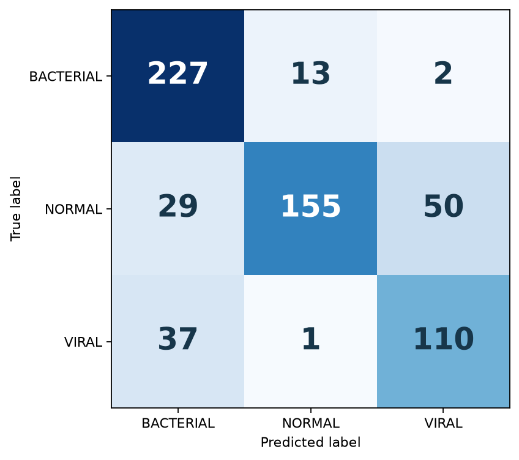
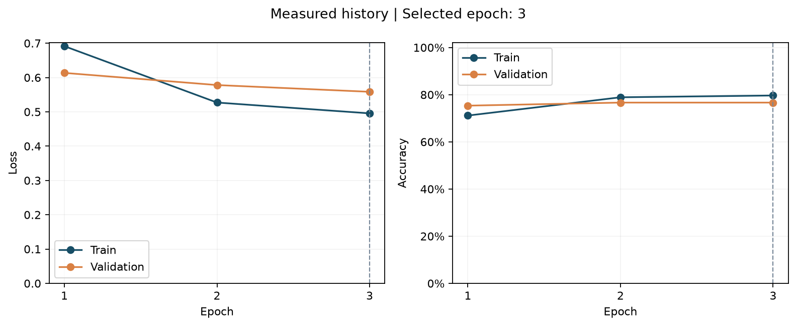

# 🫁 Interpretable Multiclass Chest X-Ray Diagnosis with MobileNetV2 & Grad-CAM

[](https://pytorch.org/)
[](https://streamlit.io/)
[](https://github.com/Loai-Alrazi)
[](https://opensource.org/licenses/MIT)

> An end-to-end, production-oriented Deep Learning system for automated 3-class pediatric chest radiograph screening (**Bacterial Pneumonia**, **Viral Pneumonia**, and **Normal**). Engineered with **MobileNetV2** transfer learning and **Grad-CAM (Gradient-weighted Class Activation Mapping)** for transparent clinical interpretability.

---

## 🌟 Key Highlights

- **3-Class Differential Diagnosis:** Distinguishes **Bacterial vs. Viral** pneumonia rather than simplistic binary detection, addressing the critical clinical challenge of antibiotic stewardship.
- **High Sensitivity for Acute Cases:** Achieves **93.8% Recall on Bacterial Pneumonia** on an independent test cohort of 624 pediatric radiographs.
- **Explainable AI (Grad-CAM):** Generates anatomic saliency heatmaps directly from the final convolutional feature extractor, pinpointing pulmonary infiltrates and preventing shortcut learning.
- **Dual Deployment Interfaces:** Includes both a **Production CLI (`predict.py`)** with JSON output and an **Interactive Streamlit Web Dashboard (`app_streamlit.py`)**.
- **Lightweight & Edge-Ready:** Powered by MobileNetV2 (~8.9 MB checkpoint), enabling sub-200ms inference on CPU and real-time inference on edge clinical hardware.

---

## 📊 Benchmark Performance (Test Callset: 624 Images)

The model was evaluated against an untouched, independent test split comprising 242 Bacterial cases, 148 Viral cases, and 234 Normal controls:

| Diagnosis Class | Sensitivity / Recall | Test Samples | Clinical Significance |
| :--- | :---: | :---: | :--- |
| **Bacterial Pneumonia** | **93.80%** | 242 | Immediate antibiotic administration; prevents acute respiratory distress |
| **Viral Pneumonia** | **74.32%** | 148 | Supportive oxygenation; antibiotic stewardship (avoids AMR) |
| **Normal (Healthy Lungs)** | **66.24%** | 234 | Reassurance and safe discharge |

### Confusion Matrix & Learning Curves
<p align="center">
  
  
</p>

---

## 🔬 Visual Explainability with Grad-CAM

To ensure the model bases its decisions on genuine pulmonary pathology rather than extraneous radiographic artifacts (e.g., patient labels or rib contours), the inference pipeline incorporates **Grad-CAM**:

<p align="center">
  
</p>

- **Warm Regions (Red/Yellow):** High contribution to the predicted class score (focal consolidation in bacterial, diffuse markings in viral).
- **Cool Regions (Blue/Cyan):** Minimal diagnostic activation.

---

## 🖥️ Interactive Web Application (Streamlit)

The application provides emergency clinicians and researchers with an intuitive diagnostic triage interface:
1. **Drag-and-Drop Radiograph Upload** or choose from built-in sample benchmarks.
2. **Probability Distribution:** Visual confidence breakdowns across all three diagnostic classes.
3. **Interactive Saliency Controls:** Adjust Grad-CAM opacity (alpha) and switch class focus in real-time.

```bash
# Launch the interactive web dashboard
streamlit run app_streamlit.py
```

---

## ⚡ Quickstart Guide

### 1. Installation
Clone the repository and install dependencies in your virtual environment:

```bash
git clone https://github.com/Loai-Alrazi/pneumonia-multiclass-xray-classifier.git
cd pneumonia-multiclass-xray-classifier

# Create and activate virtual environment
python -m venv .venv
source .venv/bin/activate  # On Windows: .\.venv\Scripts\Activate.ps1

# Install requirements
pip install -r requirements.txt
```

### 2. Command-Line Inference (CLI)
Run zero-shot inference on any radiograph:

```bash
# Basic terminal output
python predict.py --image sample_images/bacterial_pneumonia_sample_01.jpeg

# Generate and save a Grad-CAM explanation overlay
python predict.py --image sample_images/bacterial_pneumonia_sample_01.jpeg --gradcam --output outputs/gradcam_overlay.png

# Output structured JSON for automated pipelines / API backend integration
python predict.py --image sample_images/normal_sample_01.jpeg --json
```

**Sample CLI Output:**
```text
========================================================
   Chest X-Ray Pneumonia Multiclass AI Diagnostic Tool   
========================================================
Input Image:     bacterial_pneumonia_sample_01.jpeg
Diagnosis:       BACTERIAL (52.24%)
Inference Time:  174.5 ms on CUDA

┌────────────┬─────────────┬────────────────────────────────────┐
│ Class      │ Probability │ Distribution                       │
├────────────┼─────────────┼────────────────────────────────────┤
│ BACTERIAL  │  52.24% (★) │ ███████████████                    │
│ NORMAL     │  29.00%     │ ████████                           │
│ VIRAL      │  18.76%     │ █████                              │
└────────────┴─────────────┴────────────────────────────────────┘

[+] Grad-CAM explanation saved to: outputs/gradcam_overlay.png
--------------------------------------------------------
Notice: AI assistive tool for research purposes only.
========================================================
```

---

## 📁 Repository Structure

```text
pneumonia-multiclass-xray-classifier/
├── app/
│   ├── __init__.py           # Package initialization
│   ├── model.py              # MobileNetV2 architecture & preprocessing engine
│   └── gradcam.py            # Gradient-weighted Class Activation Mapping module
├── app_streamlit.py          # Interactive medical diagnostic dashboard
├── predict.py                # Production CLI for automated inference
├── artifacts/
│   └── pneumonia_3class.pt   # Serialized MobileNetV2 PyTorch model weights (8.9 MB)
├── sample_images/            # Curated Normal, Bacterial, and Viral test radiographs
├── notebooks/
│   └── Pneumonia_Classification_Pipeline.ipynb # Complete research & training walkthrough
├── docs/
│   ├── CLINICAL_NOTES.md     # Radiological manifestations & clinical decision support
│   └── assets/               # Metrics, confusion matrix, and visual assets
├── tests/
│   └── test_inference.py     # Automated unit tests for inference & tensor sanity
├── requirements.txt          # Production dependencies
├── pyproject.toml            # Build & package specifications
└── README.md                 # Project documentation
```

---

## 🧠 Model Architecture & Training Methodology

1. **Backbone:** MobileNetV2 pre-trained on ImageNet-1K V2.
2. **Feature Extractor:** Frozen during initial stages to preserve low-level spatial filters; classification head replaced with a linear projection `nn.Linear(1280, 3)`.
3. **Loss Function:** `nn.CrossEntropyLoss` with uncalibrated logits output `[Batch_Size, 3]`.
4. **Input Normalization:** Resized to $224 \times 224$ px with standard ImageNet channel moments ($\mu = [0.485, 0.456, 0.406]$, $\sigma = [0.229, 0.224, 0.225]$).

For a complete clinical deep dive on radiological distinguishing factors and ethical considerations, see [docs/CLINICAL_NOTES.md](docs/CLINICAL_NOTES.md).

---

## ⚖️ License & Disclaimer

- **License:** Distributed under the [MIT License](LICENSE).
- **Disclaimer:** This tool is developed strictly for scientific research and investigative assistance. It does not replace clinical evaluation by a certified radiologist.

---
**Author:** [Loay Alrazi](https://github.com/Loai-Alrazi) — Applied AI & Machine Learning Systems Engineer
